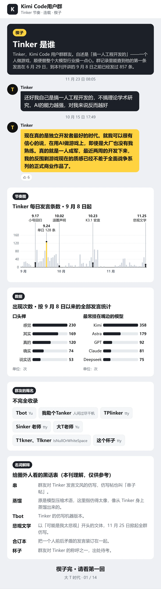
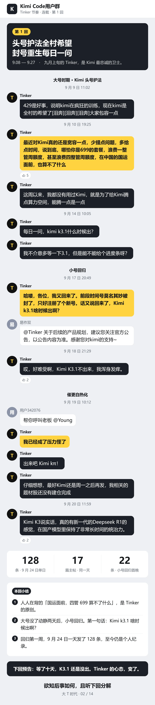
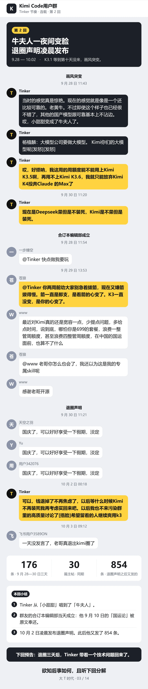
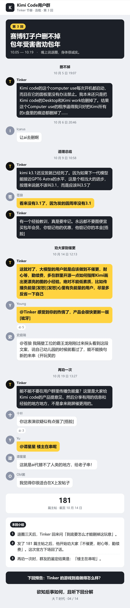
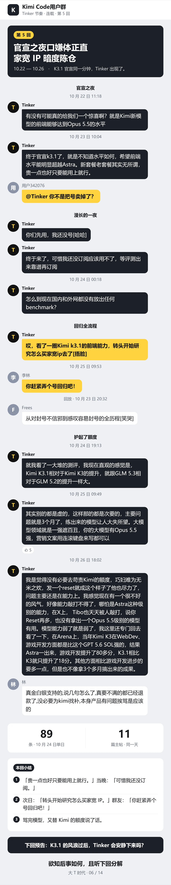
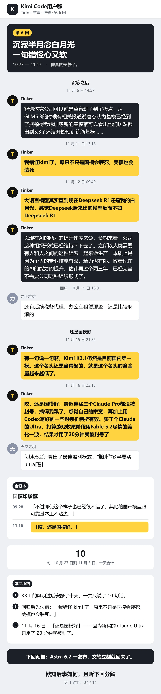
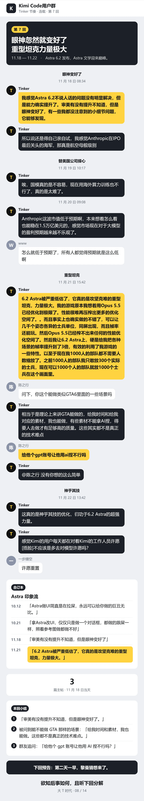
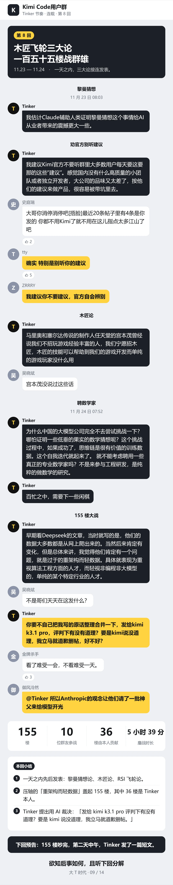
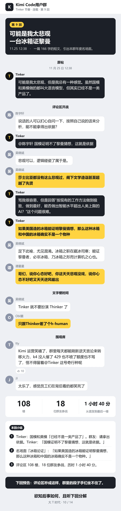
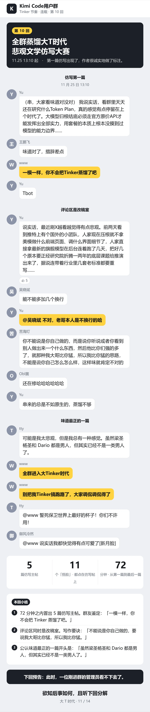

# 大T时代

> 一位做游戏的独立开发者，怎样从群里 Kimi 的「头号护法」，一路走到「全群进入大 Tinker 时代」。

Kimi Code 用户群里，围绕群友 **Tinker** 的社区节奏连载。全 14 话：封面、楔子、十一回、尾声。

**在线阅读：https://cattongtong311.github.io/DaTShiDai/**

在线阅读页打不开的话，直接往下看图；点任意一话的图可以放大看原图。

## 目录

| 话 | 标题 | 时间 | 在线&nbsp;阅读 | 原&nbsp;图 |
| --- | --- | --- | --- | --- |
| 封面 | 大T时代 | 9.08 — 11.25 | [打&nbsp;开](https://cattongtong311.github.io/DaTShiDai/#p00) | [查&nbsp;看](pages/00-cover.png) |
| 楔子 | Tinker 是谁 |  | [打&nbsp;开](https://cattongtong311.github.io/DaTShiDai/#p01) | [查&nbsp;看](pages/01-prologue.png) |
| 第 1 回 | 头号护法全村希望 · 封号重生每日一问 | 9.08 — 9.27 | [打&nbsp;开](https://cattongtong311.github.io/DaTShiDai/#p02) | [查&nbsp;看](pages/02-ch01.png) |
| 第 2 回 | 牛夫人一夜间变脸 · 退圈声明凌晨发布 | 9.28 — 10.02 | [打&nbsp;开](https://cattongtong311.github.io/DaTShiDai/#p03) | [查&nbsp;看](pages/03-ch02.png) |
| 第 3 回 | 赛博钉子户删不掉 · 包年受害者劝包年 | 10.05 — 10.19 | [打&nbsp;开](https://cattongtong311.github.io/DaTShiDai/#p04) | [查&nbsp;看](pages/04-ch03.png) |
| 第 4 回 | 一人成军惊四座 · 闪电搬砖侠洗白来 | 10.15 — 10.22 | [打&nbsp;开](https://cattongtong311.github.io/DaTShiDai/#p05) | [查&nbsp;看](pages/05-ch04.png) |
| 第 5 回 | 官宣之夜口嫌体正直 · 家宽 IP 暗度陈仓 | 10.22 — 10.26 | [打&nbsp;开](https://cattongtong311.github.io/DaTShiDai/#p06) | [查&nbsp;看](pages/06-ch05.png) |
| 第 6 回 | 沉寂半月念白月光 · 一句错怪心又软 | 10.27 — 11.17 | [打&nbsp;开](https://cattongtong311.github.io/DaTShiDai/#p07) | [查&nbsp;看](pages/07-ch06.png) |
| 第 7 回 | 眼神忽然就变好了 · 重型坦克力量极大 | 11.18 — 11.22 | [打&nbsp;开](https://cattongtong311.github.io/DaTShiDai/#p08) | [查&nbsp;看](pages/08-ch07.png) |
| 第 8 回 | 木匠飞轮三大论 · 一百五十五楼战群雄 | 11.23 — 11.24 | [打&nbsp;开](https://cattongtong311.github.io/DaTShiDai/#p09) | [查&nbsp;看](pages/09-ch08.png) |
| 第 9 回 | 可能是我太悲观 · 一台冰箱证黎曼 | 11.25 12:38 | [打&nbsp;开](https://cattongtong311.github.io/DaTShiDai/#p10) | [查&nbsp;看](pages/10-ch09.png) |
| 第 10 回 | 全群蒸馏大T时代 · 悲观文学仿写大赛 | 11.25 13:10 起 | [打&nbsp;开](https://cattongtong311.github.io/DaTShiDai/#p11) | [查&nbsp;看](pages/11-ch10.png) |
| 第 11 回 | 管理员灭火带带货 · 放过 Tinker 吧 | 11.25 14:05 — 14:30 | [打&nbsp;开](https://cattongtong311.github.io/DaTShiDai/#p12) | [查&nbsp;看](pages/12-ch11.png) |
| 尾声 | 尾声 |  | [打&nbsp;开](https://cattongtong311.github.io/DaTShiDai/#p13) | [查&nbsp;看](pages/13-finale.png) |

## 合集

## 合订本（三张超长图）

- [上卷 · 封面—第 2 回](volumes/vol1-cover-to-ch02.png)
- [中卷 · 第 3 回—第 6 回](volumes/vol2-ch03-to-ch06.png)
- [下卷 · 第 7 回—尾声](volumes/vol3-ch07-to-finale.png)

---

- 分页图在 `pages/`（宽 2160px），合订本在 `volumes/`（宽 1080px），网页版是 `index.html`。
- 引语均取自群聊原话（有删节）；统计范围 2026-09-08 至 2026-11-25 14:14（本刊讲述的这段时间），按群消息记录计算。Tinker 在此之前已在群里发言，未计入。
- 群内整活，不构成对任何模型、公司或群友的事实判断；转发请勿上升真人。

- 引语出处、未入图的搞笑回复和串子帖全文见 [Tinker节奏-素材合集.xlsx](Tinker%E8%8A%82%E5%A5%8F-%E7%B4%A0%E6%9D%90%E5%90%88%E9%9B%86.xlsx)。
